# Fensterpositionen wiederherstellen

**[English](#english) · [Deutsch](#deutsch)**

<table>
  <tr>
    <td>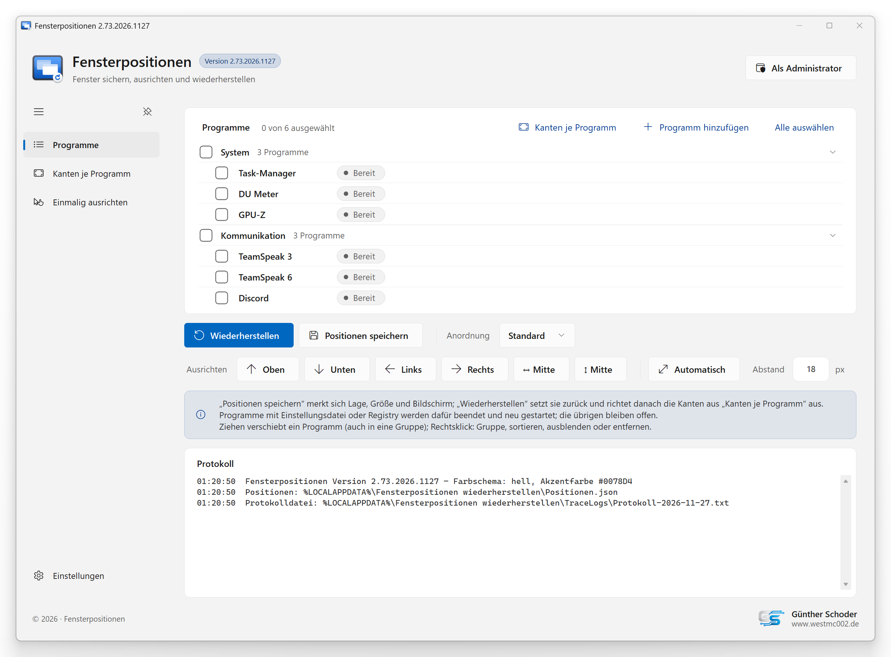</td>
    <td>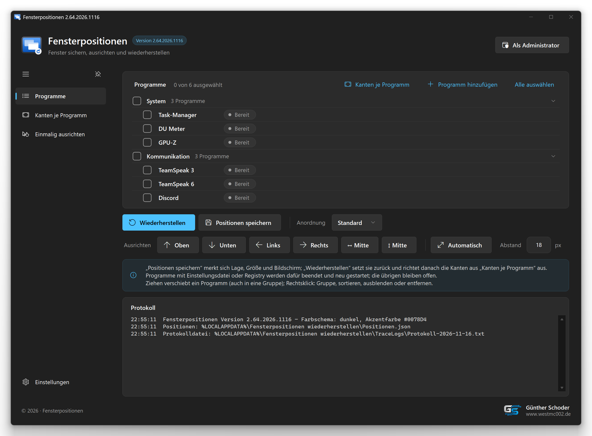</td>
  </tr>
  <tr>
    <td align="center">Light · Hell</td>
    <td align="center">Dark · Dunkel</td>
  </tr>
</table>

Author / Autor: Günther Schoder · [www.westmc002.de](https://www.westmc002.de)

---

## English

Small Windows tool that saves, aligns and restores the window positions of selected programs – in a Windows 11 design with light/dark mode and the Windows accent color.

The interface is in German.

### Features

- **Save and restore window positions** of selected programs. The program list lives in the configuration and can be extended; per program the position is taken from the open window, from its settings file (e.g. Discord, Task Manager) or from the registry (e.g. DU Meter, GPU-Z).
  - Programs that store their position in a settings file or in the registry are closed, their values are changed and the program is started again. A backup is made before every change.
  - Programs without such a file stay open; their window is measured and moved directly.
- **Add any program:** pick any open window (with a search box), its position and size are saved right away. Rename or remove it with a right-click.
- **Only what you use:** programs that are not installed are not shown; others can be hidden with a right-click (and shown again the same way) or removed. Change the order by drag & drop or sort by name; programs can be put into collapsible groups (e.g. “Kommunikation”) whose checkbox ticks all programs of the group at once. Groups can be moved and sorted on their own.
- **Programs with several windows:** windows can be added one by one by their title, e.g. the Steam main window and the friends list, which “Kanten je Programm” then docks right next to it.
- **Export and import settings:** the whole configuration with program list, positions, edges and arrangements as a JSON file, e.g. as a backup or for another PC. The import shows a preview first with the full start command and write target of every program; start commands and write targets are only taken over if they already match this PC or the program is ticked in the preview, programs on network paths or behind reparse points and special cases (service restart, ending a scheduled task) are only taken over with their own switch, update settings stay local, and the current configuration is backed up before it is replaced.
- **Align windows** to the visible window edge: top, bottom, left, right, centred horizontally (“↔ Mitte”) or vertically (“↕ Mitte”), or “Automatisch” with all edges you ticked for the program (top + bottom = full height, left + right = full width). The distance to the edge of the work area is adjustable (default 18 px). Invisible Windows borders and DPI scaling are taken into account. Your own programs have no edges preset – tick the ones you want. Each edge can get its own distance per program (e.g. left 1200 px), or take it from the window’s current position with “Messen”. An edge can also keep a distance to a neighbouring program instead of the screen edge (e.g. 18 px right of Discord). “Wiederherstellen” applies these edges after restoring.
- **Align once:** click any open window (or pick it from the list of open windows) and align it without adding it to the list; nothing is saved. The page lists what was aligned recently.
- **Several arrangements**, e.g. “Arbeit” and “Spielen”: each has its own positions and edges, switch with one click on the start page.
- **Restore without the window:** a desktop shortcut (from the arrangement menu) restores an arrangement minimised and closes again when everything worked – e.g. for the Startup folder.
- **Correction while starting:** saved alignment rules are re-applied while a program loads.
- Nothing is selected at start – only the checked programs are processed.
- Restart as administrator with one click (needed for programs running elevated).
- **Update check** against the GitHub releases (shortly after every start, or from the About window); a newer version can be installed with one click (“Jetzt aktualisieren”) or automatically when the program is idle (“Automatisch aktualisieren”, off by default), settings are kept. Only **signed updates** are installed (signed manifest with SHA-256 of the ZIP); files are replaced atomically with a journal, and an interrupted update can be rolled back.
- **Log** in the window and as a daily log file (kept 30 days).
- **Navigation on the left** like in my other programs: “Programme”, “Kanten je Programm” and “Einmalig ausrichten” are pages in the main window; settings menu at the bottom. Collapsible and pinnable.
- Windows 11 design: light/dark mode and accent color follow Windows live; messages and questions in the same design.

### Installation

1. Download the ZIP file from the [Releases](https://github.com/WestMc002/Fensterpositionen-wiederherstellen/releases) and extract it to a folder of its own with write access (needed for the automatic update), e.g. `C:\Tools\Fensterpositionen wiederherstellen`.
2. Start `Fensterpositionen wiederherstellen.exe` with a double-click.

Requirements: Windows 10 or 11 with .NET Framework 4.x (included in Windows).

Data folder: `%LOCALAPPDATA%\Fensterpositionen wiederherstellen` (saved positions, backups, log files).

At first start no positions are saved yet: arrange your windows, check the programs and click “Positionen speichern” first.

All programs are kept in a program list in `Positionen.json` (`_programme`); the program itself has no built-in programs. At first start the list is empty: add programs with “Programm hinzufügen” or import exported settings. Paths, process names and special cases (e.g. position in a settings file or the registry, service restart) can be adjusted there; the format is described in [Anleitung.txt](Anleitung.txt) (German).

### Building from source

Run `Erstellen.bat` in the project folder. It

- compiles with the C# compiler of .NET Framework 4 (no other software needed),
- assigns the version number automatically (Major.Minor.Year.MonthDay),
- on request creates the screenshots for this page from demo data (`--screenshots`),
- on request creates the signed release package in `Release` (ZIP and manifest; the private key stays outside the repository),
- backs up the project to `Backup`.

Self-test: `"Fensterpositionen wiederherstellen.exe" --self-test` (works only in the temp folder, result in `%TEMP%\Fensterpositionen wiederherstellen\Testergebnis.txt`).

---

## Deutsch

Kleines Windows-Werkzeug, das die Fensterpositionen ausgewählter Programme sichert, ausrichtet und wiederherstellt – im Windows-11-Design mit Hell/Dunkel und der Windows-Akzentfarbe.

### Funktionen

- **Fensterpositionen sichern und wiederherstellen** für ausgewählte Programme. Die Programmliste steht in der Konfiguration und lässt sich erweitern; je Programm wird die Position am offenen Fenster, in seiner Einstellungsdatei (z. B. Discord, Task-Manager) oder in der Registry (z. B. DU Meter, GPU-Z) gesichert.
  - Programme, die ihre Position in einer Einstellungsdatei oder der Registry speichern, werden beendet, die Werte geändert und das Programm wieder gestartet. Vor jeder Änderung wird eine Sicherung angelegt.
  - Programme ohne solche Datei bleiben offen; ihr Fenster wird direkt gemessen und verschoben.
- **Beliebige Programme hinzufügen:** ein geöffnetes Fenster auswählen (mit Suchfeld), Position und Größe werden gleich gespeichert. Umbenennen und entfernen per Rechtsklick.
- **Nur was du brauchst:** Programme, die nicht installiert sind, erscheinen nicht; andere lassen sich per Rechtsklick ausblenden (und genauso wieder anzeigen) oder entfernen. Die Reihenfolge lässt sich per Drag & Drop ändern oder nach Name sortieren; Programme lassen sich in einklappbare Gruppen ordnen (z. B. „Kommunikation“), deren Kästchen alle Programme der Gruppe auf einmal anhakt. Gruppen lassen sich verschieben und einzeln sortieren.
- **Programme mit mehreren Fenstern:** Fenster lassen sich einzeln über ihren Titel aufnehmen, z. B. das Steam-Hauptfenster und die Freundesliste, die dann per „Kanten je Programm“ direkt daneben angedockt wird.
- **Einstellungen exportieren und importieren:** die ganze Konfiguration mit Programmliste, Positionen, Kanten und Anordnungen als JSON-Datei, z. B. als Sicherung oder für einen anderen PC. Der Import zeigt erst eine Vorschau mit vollständigem Startbefehl und Schreibziel jedes Programms; Startbefehl und Schreibziel gelten nur, wenn sie schon so auf diesem PC stehen oder das Programm in der Vorschau angehakt ist, Programme mit Netzwerkpfad oder hinter Reparse Points und Sonderfälle (Dienst neu starten, geplante Aufgabe beenden) werden nur mit eigenem Schalter übernommen, Update-Einstellungen bleiben lokal, und die bisherige Konfiguration wird vor dem Ersetzen gesichert.
- **Fenster ausrichten** an der sichtbaren Fensterkante: oben, unten, links, rechts, waagerecht („↔ Mitte“) oder senkrecht („↕ Mitte“) mittig, oder „Automatisch“ mit allen Kanten, die je Programm angehakt sind (oben + unten = volle Höhe, links + rechts = volle Breite). Der Abstand zum Rand des Arbeitsbereichs ist einstellbar (Standard 18 px). Unsichtbare Windows-Fensterrahmen und DPI-Skalierung werden berücksichtigt. Eigene Programme haben keine Kanten-Vorgabe – die gewünschten selbst anhaken. Jede Kante kann je Programm einen eigenen Abstand bekommen (z. B. links 1200 px) oder ihn mit „Messen“ von der aktuellen Fensterposition übernehmen. Statt zum Bildschirmrand kann eine Kante auch einen Abstand zu einem Nachbarprogramm halten (z. B. 18 px rechts neben Discord). „Wiederherstellen“ richtet diese Kanten danach aus.
- **Einmalig ausrichten:** ein beliebiges offenes Fenster anklicken (oder aus der Liste der offenen Fenster wählen) und ausrichten, ohne es in die Liste aufzunehmen; nichts wird gespeichert. Die Seite zeigt, was zuletzt ausgerichtet wurde.
- **Mehrere Anordnungen**, z. B. „Arbeit“ und „Spielen“: jede mit eigenen Positionen und Kanten, umschaltbar auf der Startseite.
- **Wiederherstellen ohne Fenster:** eine Verknüpfung auf dem Desktop (aus dem Anordnungs-Menü) stellt eine Anordnung minimiert wieder her und beendet sich, wenn alles geklappt hat – z. B. für den Autostart-Ordner.
- **Nachkorrektur beim Start:** gespeicherte Ausrichtungen werden während der Ladephase eines Programms erneut angewandt.
- Beim Start ist nichts angehakt – bearbeitet wird nur, was angehakt ist.
- Neustart als Administrator per Klick (nötig für Programme, die mit Administratorrechten laufen).
- **Update-Prüfung** über die GitHub-Releases (kurz nach jedem Start oder im Info-Fenster); eine neuere Version lässt sich per Klick installieren („Jetzt aktualisieren“) oder automatisch, sobald das Programm nichts zu tun hat („Automatisch aktualisieren“, Standard aus), Einstellungen bleiben erhalten. Installiert werden nur **signierte Updates** (signiertes Manifest mit SHA-256 des ZIP); die Dateien werden mit Journal ausgetauscht, ein abgebrochenes Update lässt sich zurücksetzen.
- **Protokoll** im Fenster und als Tagesdatei (30 Tage aufbewahrt).
- **Navigation links** wie in meinen anderen Programmen: „Programme“, „Kanten je Programm“ und „Einmalig ausrichten“ sind Seiten im Hauptfenster; unten das Einstellungsmenü. Einklappbar und anpinnbar.
- Windows-11-Design: Hell/Dunkel und Akzentfarbe folgen Windows sofort; Meldungen und Rückfragen im selben Design.

### Installation

1. Die ZIP-Datei aus den [Releases](https://github.com/WestMc002/Fensterpositionen-wiederherstellen/releases) herunterladen und in einen eigenen Ordner mit Schreibrechten entpacken (nötig für die automatische Aktualisierung), z. B. `C:\Tools\Fensterpositionen wiederherstellen`.
2. `Fensterpositionen wiederherstellen.exe` per Doppelklick starten.

Voraussetzungen: Windows 10 oder 11 mit .NET Framework 4.x (in Windows enthalten).

Datenordner: `%LOCALAPPDATA%\Fensterpositionen wiederherstellen` (gespeicherte Positionen, Sicherungen, Protokolldateien).

Beim ersten Start sind noch keine Positionen gespeichert: Fenster anordnen, Programme anhaken und zuerst „Positionen speichern“ anklicken.

Alle Programme stehen in einer Programmliste in `Positionen.json` (`_programme`); das Programm selbst enthält keine fest eingebauten Programme. Beim ersten Start ist die Liste leer: Programme über „Programm hinzufügen“ aufnehmen oder exportierte Einstellungen importieren. Pfade, Prozessnamen und Sonderfälle (z. B. Position in einer Einstellungsdatei oder der Registry, Dienst-Neustart) lassen sich in der Liste anpassen; der Aufbau steht in der [Anleitung](Anleitung.txt).

Ausführliche Anleitung: [Anleitung.txt](Anleitung.txt).

### Selbst kompilieren

`Erstellen.bat` im Projektordner starten. Sie

- kompiliert mit dem C#-Compiler des .NET Framework 4 (keine weitere Software nötig),
- vergibt die Versionsnummer automatisch (Haupt.Neben.Jahr.MonatTag),
- erzeugt auf Nachfrage die Screenshots für diese Seite aus Beispieldaten (`--screenshots`),
- erstellt auf Nachfrage das signierte Release-Paket in `Release` (ZIP und Manifest; der private Schlüssel liegt außerhalb des Repositorys),
- sichert das Projekt unter `Backup`.

Selbsttest: `"Fensterpositionen wiederherstellen.exe" --self-test` (arbeitet nur im Temp-Ordner, Ergebnis in `%TEMP%\Fensterpositionen wiederherstellen\Testergebnis.txt`).

---

## Screenshots

<table>
  <tr>
    <td>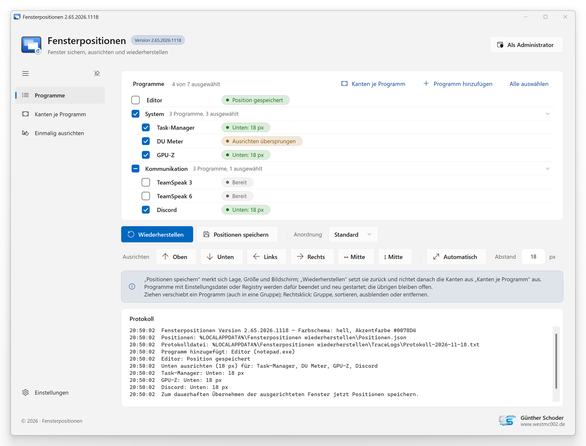</td>
    <td>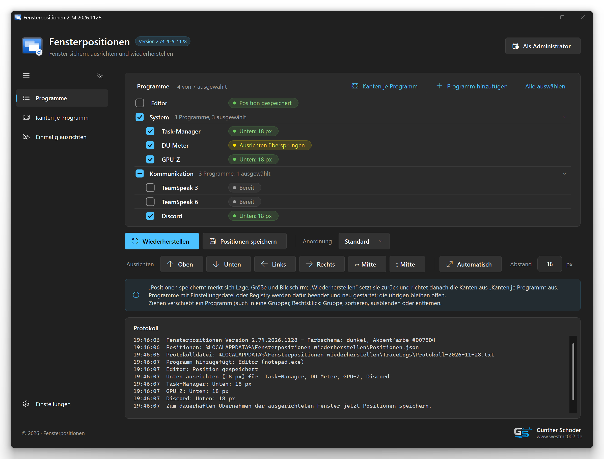</td>
  </tr>
  <tr><td colspan="2" align="center">Own program added, windows aligned · Eigenes Programm hinzugefügt, Fenster ausgerichtet</td></tr>
  <tr>
    <td>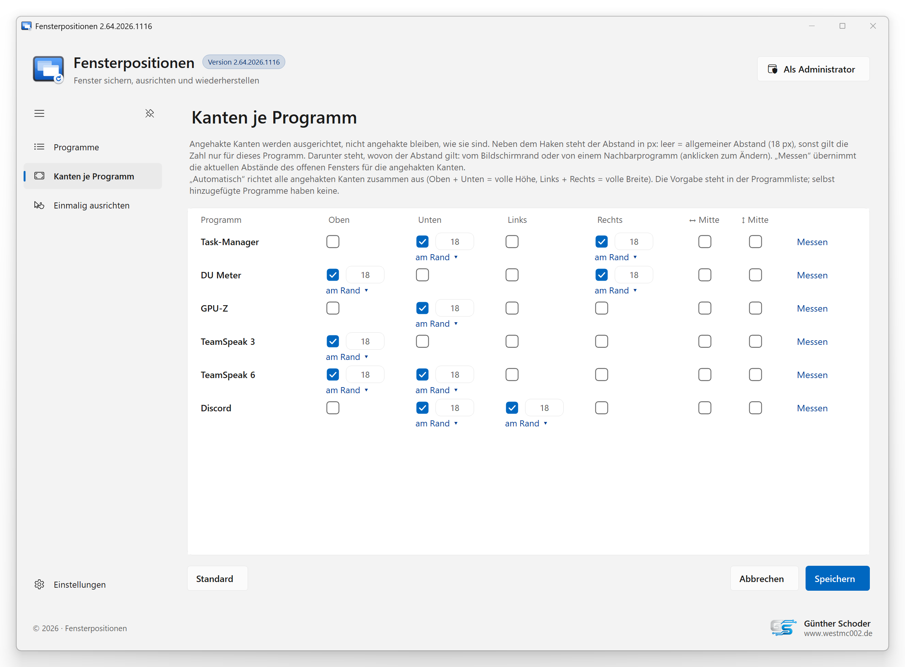</td>
    <td>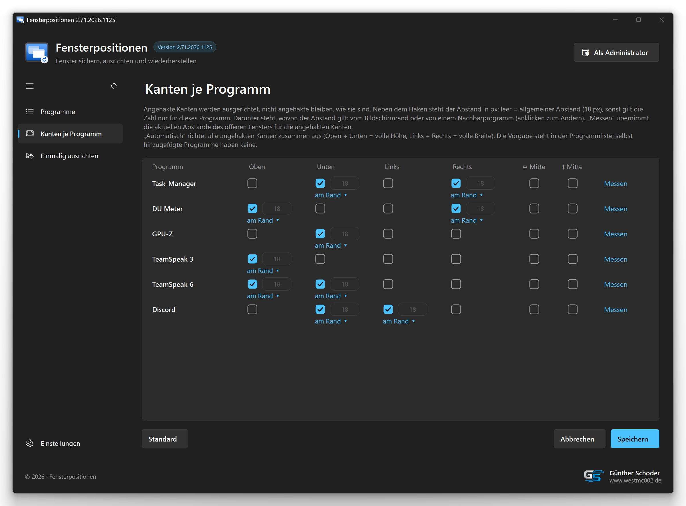</td>
  </tr>
  <tr><td colspan="2" align="center">Edges per program · Kanten je Programm</td></tr>
  <tr>
    <td>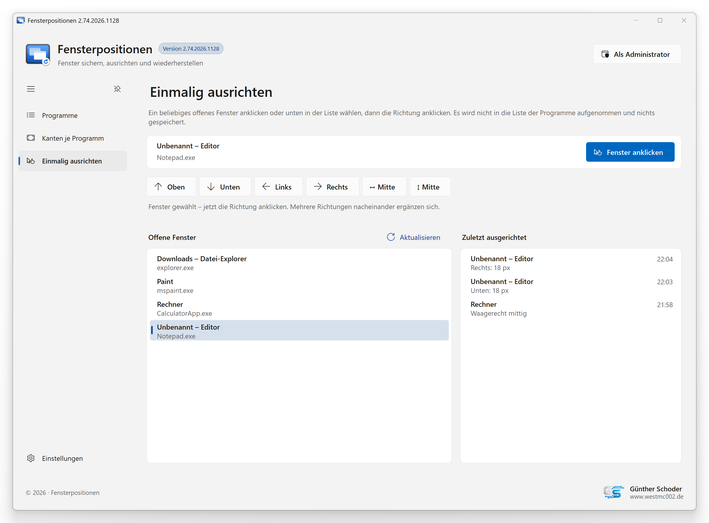</td>
    <td>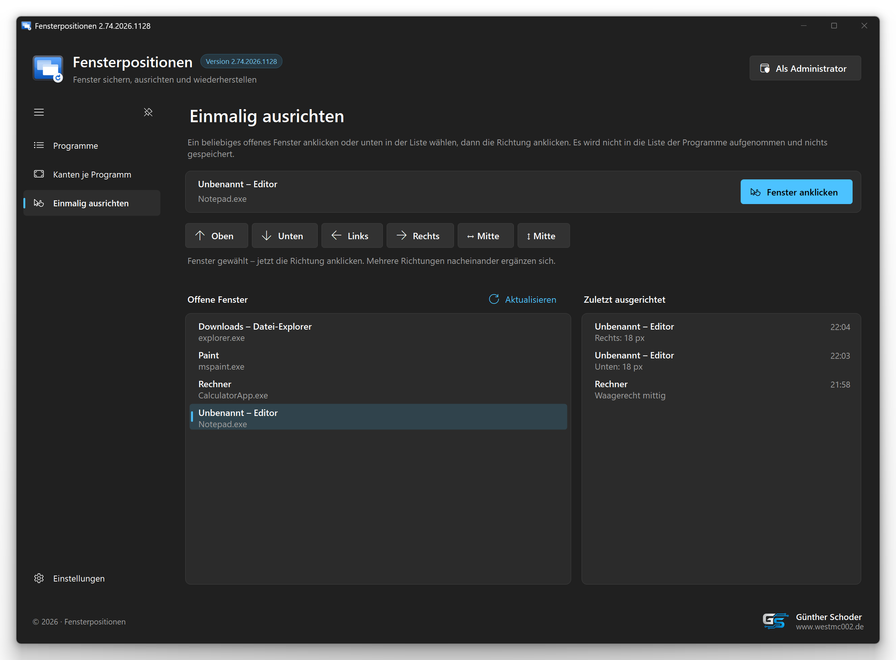</td>
  </tr>
  <tr><td colspan="2" align="center">Align once · Einmalig ausrichten</td></tr>
  <tr>
    <td>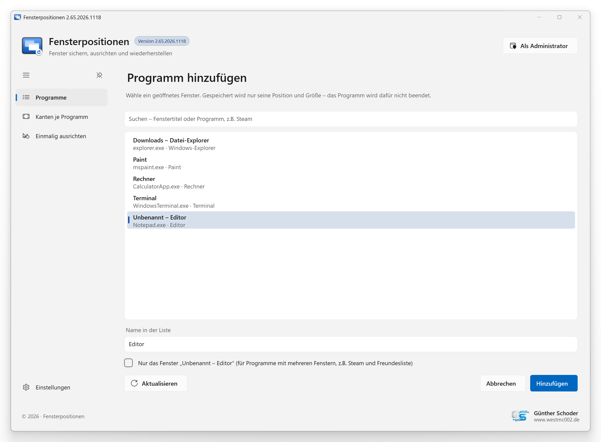</td>
    <td>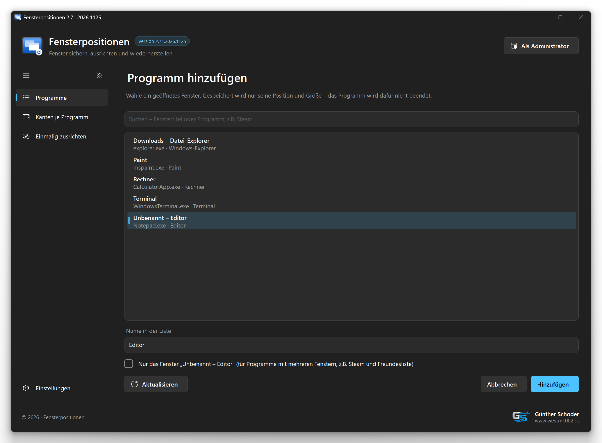</td>
  </tr>
  <tr><td colspan="2" align="center">Add any open window · Beliebiges geöffnetes Fenster hinzufügen</td></tr>
  <tr>
    <td>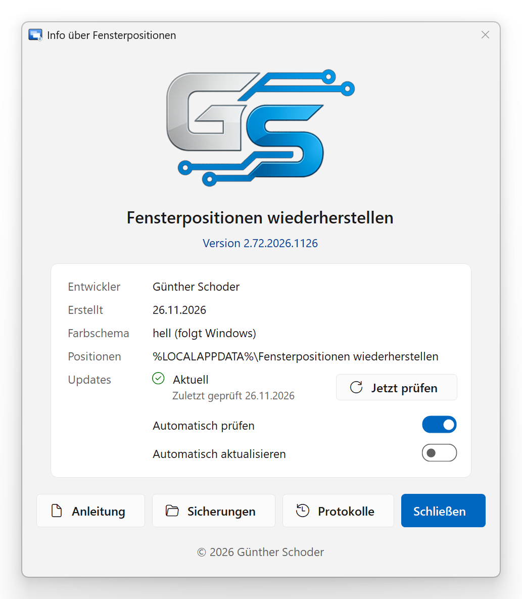</td>
    <td>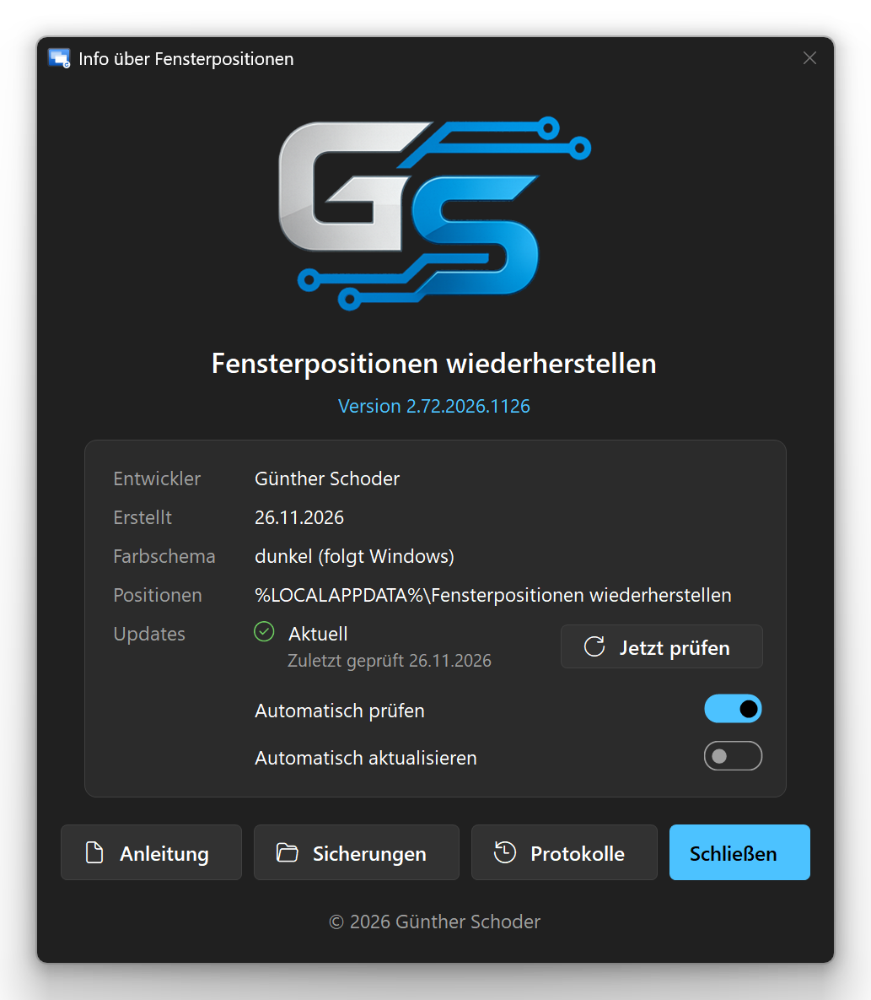</td>
  </tr>
  <tr><td colspan="2" align="center">About window · Info-Fenster</td></tr>
</table>

The screenshots are created by the program itself from demo data (`--screenshots`, without personal data) · Die Bilder erzeugt das Programm selbst aus Beispieldaten (`--screenshots`, ohne persönliche Daten).

## Project structure / Projektaufbau

| Folder / file · Ordner / Datei | Content · Inhalt |
|---|---|
| `Quellcode` | C# source code · C#-Quellcode |
| `Resources` | icon and logo · Icon und Logo |
| `Screenshots` | images for this page (demo view) · Bilder für diese Seite (Demo-Ansicht) |
| `Erstellen.bat` | build script · Build-Skript |
| `Release` | signed release package (ZIP and manifest) · signiertes Release-Paket (ZIP und Manifest) |
| `Anleitung.txt` | manual (German) · Anleitung |

## License / Lizenz

GNU General Public License v3.0 or later · GNU General Public License v3.0 oder später – [LICENSE](LICENSE).

© 2026 Günther Schoder

**Exception / Ausnahme:** The GS logo (`Resources/GS-Logo.png`) is excluded from the GPL. All rights reserved; it may only be redistributed unchanged together with this program. · Das GS-Logo (`Resources/GS-Logo.png`) ist von der GPL ausgenommen. Alle Rechte vorbehalten; es darf nur zusammen mit diesem Programm in unveränderter Form weitergegeben werden.

This project is not affiliated with or endorsed by Microsoft or the makers of the programs mentioned (DU Meter, TeamSpeak, Discord, GPU-Z, Steam). Windows is a trademark of Microsoft Corporation; all other names are trademarks of their respective owners. · Dieses Projekt ist nicht mit Microsoft oder den Herstellern der genannten Programme (DU Meter, TeamSpeak, Discord, GPU-Z, Steam) verbunden und wird nicht von ihnen unterstützt. Windows ist eine Marke der Microsoft Corporation; alle anderen Namen sind Marken ihrer jeweiligen Inhaber.
