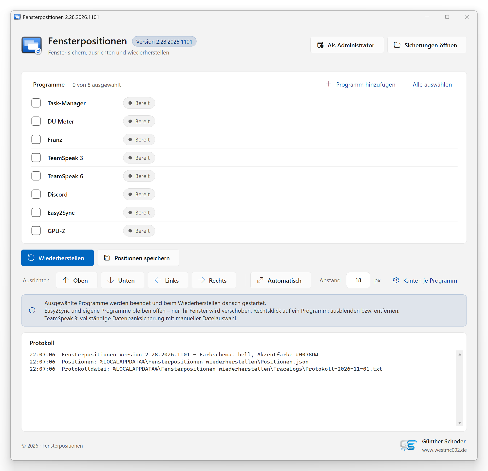
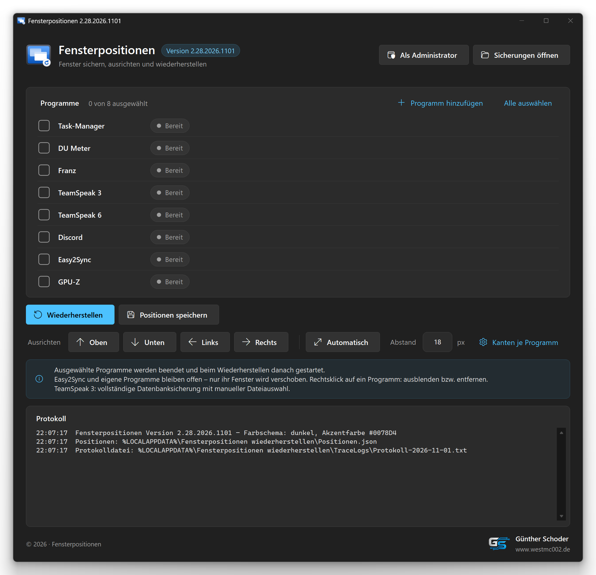
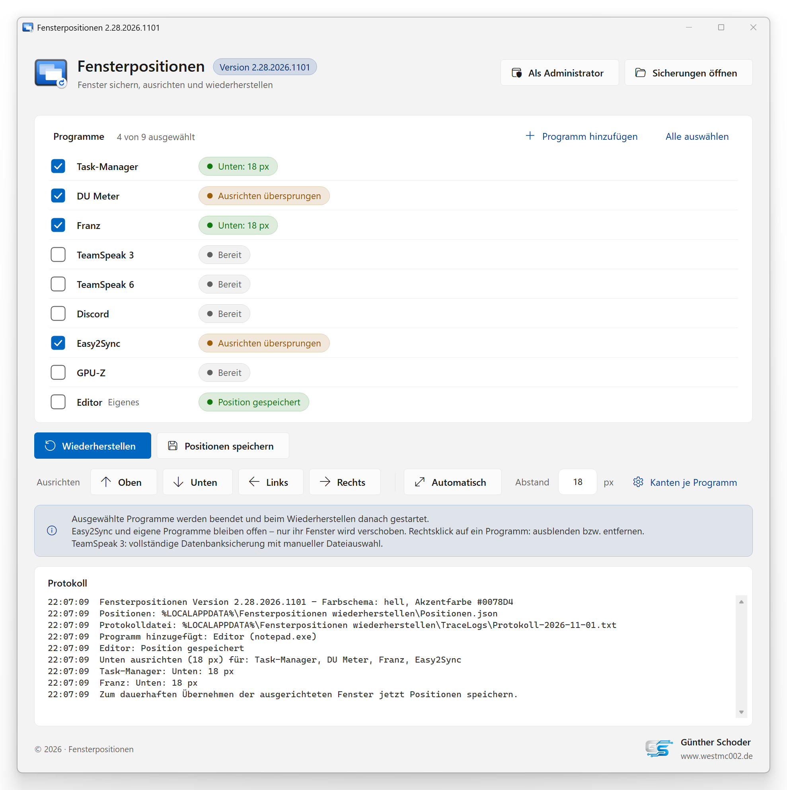
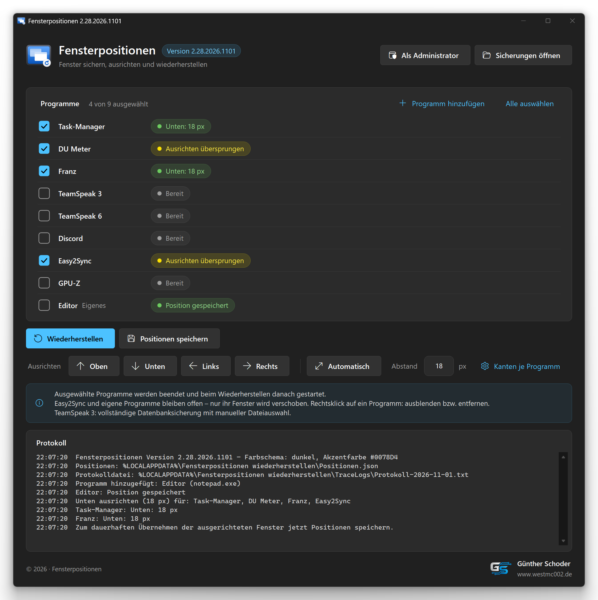
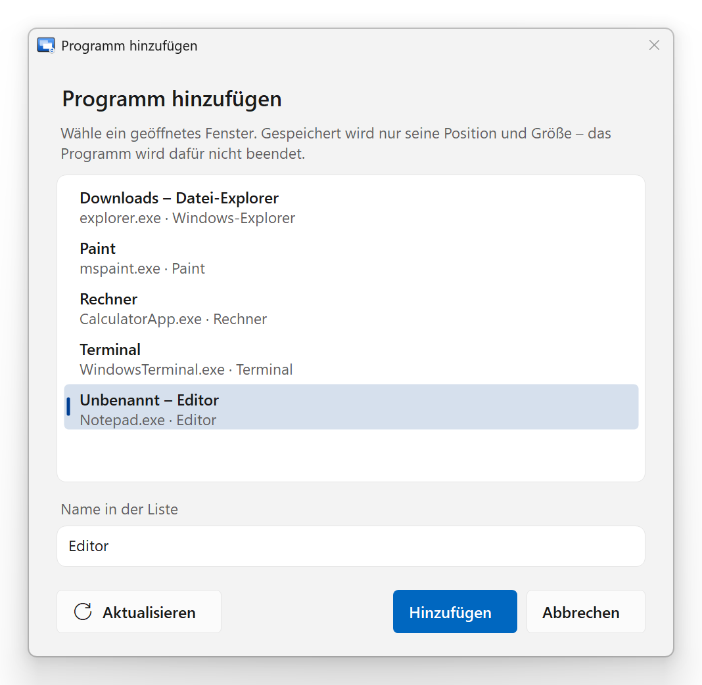
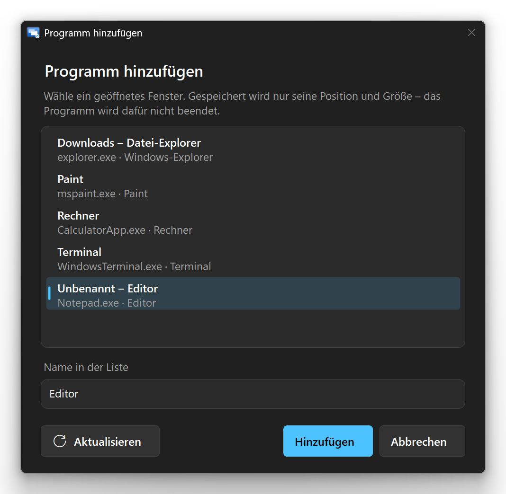
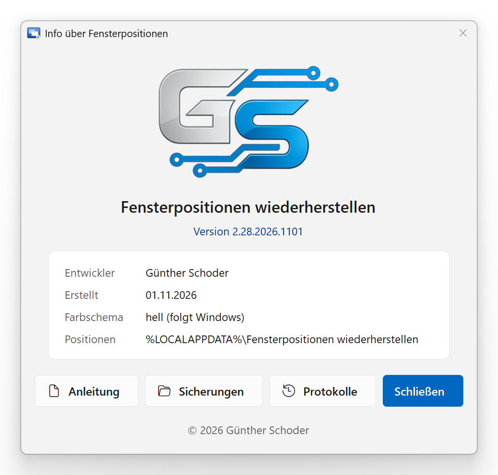
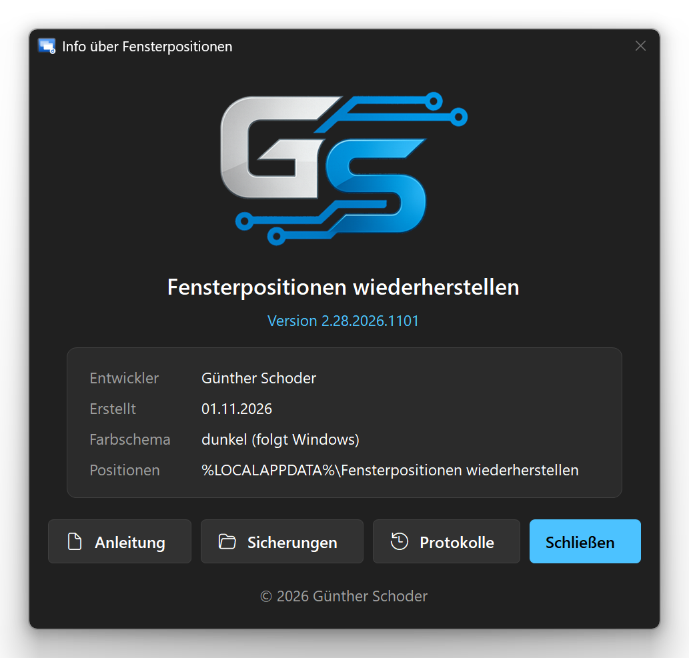

# Fensterpositionen wiederherstellen

**[English](#english) · [Deutsch](#deutsch)**

<table>
  <tr>
    <td></td>
    <td></td>
  </tr>
  <tr>
    <td align="center">Light · Hell</td>
    <td align="center">Dark · Dunkel</td>
  </tr>
</table>

Author / Autor: Günther Schoder · [www.westmc002.de](https://www.westmc002.de)

---

## English

Small Windows tool that saves, aligns and restores the window positions of selected programs – in a Windows 11 design with light/dark mode and the Windows accent color.

The interface is in German.

### Features

- **Save and restore window positions** of selected programs. Built in: Task Manager, DU Meter, Franz, TeamSpeak 3 and 6, Discord, Easy2Sync and GPU-Z.
  - Programs that store their position in a settings file or in the registry are closed, their values are changed and the program is started again. A backup is made before every change.
  - Easy2Sync and your own programs stay open; their window is measured and moved directly.
- **Add any program:** pick any open window, its position and size are saved right away. Remove it again with a right-click.
- **Only what you use:** built-in programs that are not installed are not shown; others can be hidden with a right-click (and shown again the same way).
- **Align windows** to the visible window edge: top, bottom, left or right, or “Automatisch” with all edges you ticked for the program (top + bottom = full height, left + right = full width, centre). The distance to the edge of the work area is adjustable (default 18 px). Invisible Windows borders and DPI scaling are taken into account.
- **Correction while starting:** saved alignment rules are re-applied while a program loads.
- Nothing is selected at start – only the checked programs are processed.
- Restart as administrator with one click (needed for programs running elevated).
- **Log** in the window and as a daily log file (kept 30 days).
- Windows 11 design: light/dark mode and accent color follow Windows live.

### Installation

1. Download the ZIP file from the [Releases](https://github.com/WestMc002/Fensterpositionen-wiederherstellen/releases) and extract it to any folder.
2. Start `Fensterpositionen wiederherstellen.exe` with a double-click.

Requirements: Windows 10 or 11 with .NET Framework 4.x (included in Windows).

Data folder: `%LOCALAPPDATA%\Fensterpositionen wiederherstellen` (saved positions, backups, log files).

At first start no positions are saved yet: arrange your windows, check the programs and click “Positionen speichern” first.

The built-in programs use the usual installation paths (e.g. `C:\Program Files (x86)\…`). Those not found are not shown. Programs installed elsewhere can be added with “Programm hinzufügen”.

### Building from source

Run `Erstellen.bat` in the project folder. It

- compiles with the C# compiler of .NET Framework 4 (no other software needed),
- assigns the version number automatically (Major.Minor.Year.MonthDay),
- on request creates the screenshots for this page from demo data (`--screenshots`),
- backs up the project to `Backup`.

Self-test: `"Fensterpositionen wiederherstellen.exe" --self-test` (works only in the temp folder, result in `%TEMP%\Fensterpositionen wiederherstellen\Testergebnis.txt`).

---

## Deutsch

Kleines Windows-Werkzeug, das die Fensterpositionen ausgewählter Programme sichert, ausrichtet und wiederherstellt – im Windows-11-Design mit Hell/Dunkel und der Windows-Akzentfarbe.

### Funktionen

- **Fensterpositionen sichern und wiederherstellen** für ausgewählte Programme. Fest eingebaut: Task-Manager, DU Meter, Franz, TeamSpeak 3 und 6, Discord, Easy2Sync und GPU-Z.
  - Programme, die ihre Position in einer Einstellungsdatei oder der Registry speichern, werden beendet, die Werte geändert und das Programm wieder gestartet. Vor jeder Änderung wird eine Sicherung angelegt.
  - Easy2Sync und eigene Programme bleiben offen; ihr Fenster wird direkt gemessen und verschoben.
- **Beliebige Programme hinzufügen:** ein geöffnetes Fenster auswählen, Position und Größe werden gleich gespeichert. Entfernen per Rechtsklick.
- **Nur was du brauchst:** Fest eingebaute Programme, die nicht installiert sind, erscheinen nicht; andere lassen sich per Rechtsklick ausblenden (und genauso wieder anzeigen).
- **Fenster ausrichten** an der sichtbaren Fensterkante: oben, unten, links oder rechts, oder „Automatisch“ mit allen Kanten, die je Programm angehakt sind (oben + unten = volle Höhe, links + rechts = volle Breite, Mitte). Der Abstand zum Rand des Arbeitsbereichs ist einstellbar (Standard 18 px). Unsichtbare Windows-Fensterrahmen und DPI-Skalierung werden berücksichtigt.
- **Nachkorrektur beim Start:** gespeicherte Ausrichtungen werden während der Ladephase eines Programms erneut angewandt.
- Beim Start ist nichts angehakt – bearbeitet wird nur, was angehakt ist.
- Neustart als Administrator per Klick (nötig für Programme, die mit Administratorrechten laufen).
- **Protokoll** im Fenster und als Tagesdatei (30 Tage aufbewahrt).
- Windows-11-Design: Hell/Dunkel und Akzentfarbe folgen Windows sofort.

### Installation

1. Die ZIP-Datei aus den [Releases](https://github.com/WestMc002/Fensterpositionen-wiederherstellen/releases) herunterladen und in einen beliebigen Ordner entpacken.
2. `Fensterpositionen wiederherstellen.exe` per Doppelklick starten.

Voraussetzungen: Windows 10 oder 11 mit .NET Framework 4.x (in Windows enthalten).

Datenordner: `%LOCALAPPDATA%\Fensterpositionen wiederherstellen` (gespeicherte Positionen, Sicherungen, Protokolldateien).

Beim ersten Start sind noch keine Positionen gespeichert: Fenster anordnen, Programme anhaken und zuerst „Positionen speichern“ anklicken.

Die fest eingebauten Programme werden an den üblichen Installationsorten erwartet (z. B. `C:\Program Files (x86)\…`). Nicht gefundene werden nicht angezeigt. Anders installierte Programme lassen sich über „Programm hinzufügen“ aufnehmen.

Ausführliche Anleitung: [Anleitung.txt](Anleitung.txt).

### Selbst kompilieren

`Erstellen.bat` im Projektordner starten. Sie

- kompiliert mit dem C#-Compiler des .NET Framework 4 (keine weitere Software nötig),
- vergibt die Versionsnummer automatisch (Haupt.Neben.Jahr.MonatTag),
- erzeugt auf Nachfrage die Screenshots für diese Seite aus Beispieldaten (`--screenshots`),
- sichert das Projekt unter `Backup`.

Selbsttest: `"Fensterpositionen wiederherstellen.exe" --self-test` (arbeitet nur im Temp-Ordner, Ergebnis in `%TEMP%\Fensterpositionen wiederherstellen\Testergebnis.txt`).

---

## Screenshots

<table>
  <tr>
    <td></td>
    <td></td>
  </tr>
  <tr><td colspan="2" align="center">Own program added, windows aligned · Eigenes Programm hinzugefügt, Fenster ausgerichtet</td></tr>
  <tr>
    <td></td>
    <td></td>
  </tr>
  <tr><td colspan="2" align="center">Add any open window · Beliebiges geöffnetes Fenster hinzufügen</td></tr>
  <tr>
    <td></td>
    <td></td>
  </tr>
  <tr><td colspan="2" align="center">About window · Info-Fenster</td></tr>
</table>

The screenshots are created by the program itself from demo data (`--screenshots`, without personal data) · Die Bilder erzeugt das Programm selbst aus Beispieldaten (`--screenshots`, ohne persönliche Daten).

## Project structure / Projektaufbau

| Folder / file · Ordner / Datei | Content · Inhalt |
|---|---|
| `Quellcode` | C# source code · C#-Quellcode |
| `Resources` | icon and logo · Icon und Logo |
| `Screenshots` | images for this page (demo view) · Bilder für diese Seite (Demo-Ansicht) |
| `Erstellen.bat` | build script · Build-Skript |
| `Anleitung.txt` | manual (German) · Anleitung |

## License / Lizenz

GNU General Public License v3.0 or later · GNU General Public License v3.0 oder später – [LICENSE](LICENSE).

© 2026 Günther Schoder

**Exception / Ausnahme:** The GS logo (`Resources/GS-Logo.png`) is excluded from the GPL. All rights reserved; it may only be redistributed unchanged together with this program. · Das GS-Logo (`Resources/GS-Logo.png`) ist von der GPL ausgenommen. Alle Rechte vorbehalten; es darf nur zusammen mit diesem Programm in unveränderter Form weitergegeben werden.

This project is not affiliated with or endorsed by Microsoft or the makers of the programs mentioned (DU Meter, Franz, TeamSpeak, Discord, Easy2Sync, GPU-Z). Windows is a trademark of Microsoft Corporation; all other names are trademarks of their respective owners. · Dieses Projekt ist nicht mit Microsoft oder den Herstellern der genannten Programme (DU Meter, Franz, TeamSpeak, Discord, Easy2Sync, GPU-Z) verbunden und wird nicht von ihnen unterstützt. Windows ist eine Marke der Microsoft Corporation; alle anderen Namen sind Marken ihrer jeweiligen Inhaber.
